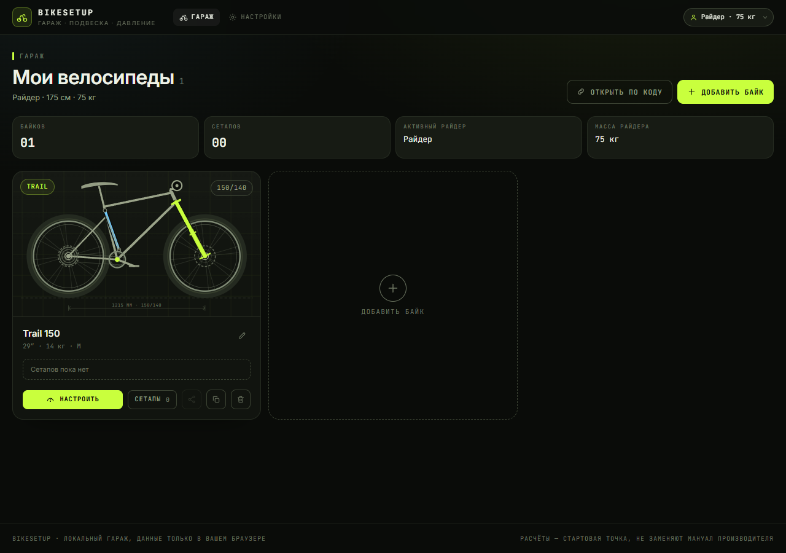
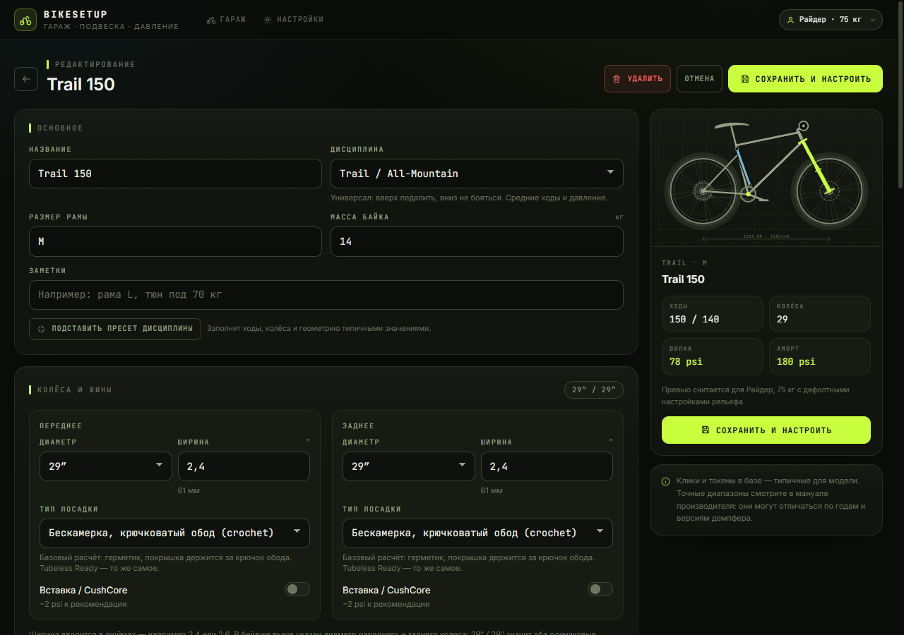

# BIKESETUP

**Калькулятор настройки велосипедной подвески.** Подсказывает, сколько качать в вилку
и аморт, какой сэг ловить, сколько кликов отскока и ABS+ крутить, какое давление
держать в шинах и какой ширины ставить руль — под ваш вес, байк, дисциплину и погоду.

Работает целиком локально: данные хранятся только в вашем браузере, никакого сервера,
никаких аккаунтов и регистрации.

## Как это работает

1. Добавьте байк в гараж: дисциплина, ходы подвески, колеса, шины, вилка и аморт
   (можно выбрать модель из базы или задать параметры вручную).
2. Укажите свой вес в экипировке, рост и погоду на трейле.
3. Нажмите «Сохранить и настроить» — калькулятор выдаст стартовые значения: давление
   в вилке и аморте (или жёсткость пружины), сэг в мм и процентах, токены, клики
   демпфирования, давление в шинах в psi и bar, ширину руля.
4. Прокатитесь, проверьте реальный сэг и подкорректируйте настройки под свои ощущения.

Каждый результат можно раскрыть и посмотреть, откуда взялось число: формула, шаг за
шагом. Это не чёрный ящик.

## Почему расчёты сходятся с мануалом

Большинство калькуляторов давления считают от **полного веса** — райдер плюс байк.
Это завышает давление. BIKESETUP считает от **веса райдера в экипировке**, как и
таблицы RockShox и Fox. На холодной погоде давление растёт, а масло густеет — поэтому
отскок открывается на несколько кликов быстрее. Расчёт шин и сэга — с поправками на
ширину резины, дисциплину и состояние трейла.

## Что умеет

- **Гараж.** Несколько байков, профили райдеров, пресеты дисциплин: XC / Downcountry,
  Trail / All-Mountain, Enduro, DH / Freeride, Dirt / Street, Gravel.
- **Подвеска.** Воздух, пружина или ригид спереди и сзади. База популярных вилок и
  амортов. Регулировки отмечаются по факту: отскок, LSC, HSC, ABS+, блокировка,
  преднатяг. Если токенов нет или вы не знаете, сколько стоит — есть переключатель
  «не знаю».
- **Развесовка.** Геометрия байка и позиция райдера дают нагрузку перед / зад.
  Быстрые пресеты стойки: «Атака», «Нейтраль», «Назад». Сдвиг ЦМ меняет нагрузку
  на колёса, а значит и давление в вилке, аморте и шинах.
- **Шины.** Отдельный тип посадки на каждое колесо: камера, TPU/латекс, бескамерка
  на крючковатом (crochet) или прямом (hookless / TSS) ободе, трубка (tubular).
  Давление считается с поправкой на посадку и на долю веса, которая приходится
  на это колесо.
- **История и обмен.** Несколько сетапов на байк. Обмен кодом `BS1-…` или ссылкой —
  получатель открывает сетап в режиме просмотра.
- **Бэкап.** Экспорт и импорт всего гаража в JSON — перенос данных на другое
  устройство или в другую версию.

## Скриншоты

## Windows-версия

Портативный файл `BIKESETUP-…-portable.exe` — ничего устанавливать не нужно,
интернет тоже не нужен: запускается двойным кликом и работает как обычная программа.

- Данные хранятся в `%APPDATA%\BIKESETUP`.
- Файл не подписан сертификатом, поэтому Windows SmartScreen может предупредить.
  Чтобы запустить: «Подробнее» → «Выполнить в любом случае».

## Веб-версия

Откройте приложение в браузере и добавьте в закладки. Данные хранятся в браузере
(`localStorage`), поэтому попадут в экспорт JSON — сделайте **бэкап перед тем, как
чистить данные браузера или менять устройство**.

## Важно знать

- **Данные привязаны к браузеру (или к программе на Windows).** Очистка данных сайта,
  режим инкогнито или другой браузер — чистый лист. Для переноса используйте экспорт
  и импорт JSON.
- **База вилок и амортов — типичные настройки моделей.** Точные диапазоны кликов и
  токенов смотрите в мануале производителя: они отличаются по годам и версиям
  демпфера. Если модели нет в базе — задайте параметры вручную.
- **Бюджетные воздушки** (2Roxx, Bolany, Zoom и подобные) при «правильном» по
  манометру давлении могут не давать сэга: большая воздушная камера, простая
  негативка, трение сальников. Это не ошибка калькулятора — ориентируйтесь на
  реальный сэг. Если сэга нет даже при 50 psi, проверьте, что вилка воздушная, и
  убедитесь, что нет перетяжки. Часто помогает обслуживание: смазка сальников,
  свежее масло. Только после этого подгоняйте давление.
- **Расчёты — стартовая точка,** а не замена мануалу производителя. Проверяйте сэг
  и давления на своём байке и в своих условиях.

Запуск и сборку из исходников смотрите в `CONTRIBUTING.md`, историю версий — в
`CHANGELOG.md`.
